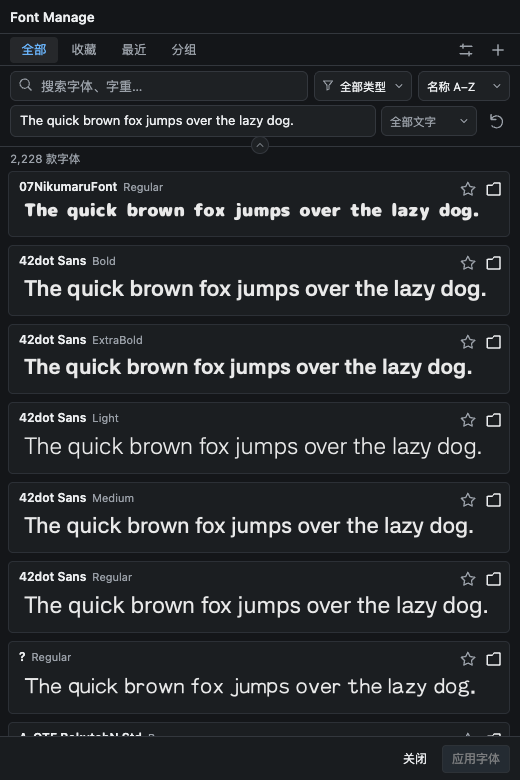
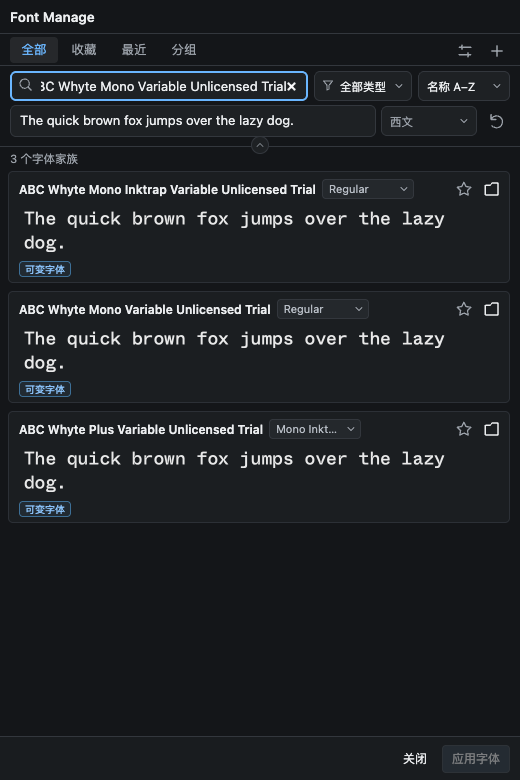

# Font Manage

[](../../releases/latest)
[](LICENSE)
[](../../releases)

A compact font manager for **Affinity on macOS**: browse real CoreText-rendered previews, compare a family's styles from one card, filter by actual script coverage, and apply the selected font safely to the current text selection.

一款面向 **macOS Affinity** 的紧凑字体管理工具：真实 CoreText 字体预览、同一家族字款合并选择、按实际文字系统覆盖筛选，并安全地把选中字款应用到当前文本对象。




## What it does / 功能

- **Real previews, not font names / 真实预览** — every row is rendered by the system CoreText stack in the target font; missing glyphs, blocked fallbacks and partial coverage are shown as tappable badges. 每行都由 CoreText 按目标字款真实绘制；缺字、阻止回退、部分覆盖以小胶囊提示，点击查看详情。
- **Family-grouped style picker / 家族字款下拉** — one card per family; Regular/Normal is the default screen-readable face, and the dropdown keeps every style available even after an exact style search. 同一家族合并为一张卡片，默认展示易读字款；精确搜索后仍可切换其他字款。
- **Variable-font tags / 可变字体标签** — variable faces show a blue “可变字体” tag below the preview, separate from missing-glyph and duplicate-font warnings. 可变字体在样本下方显示蓝色信息 tag，与缺字、重复字体警示区分。
- **Script coverage filtering / 按文字系统筛选** — Latin, Simplified Chinese, Traditional Chinese, Japanese, Korean, digits and symbols, each with its own core character set. Fonts below the core-coverage threshold are excluded; partial coverage stays visible. 西文、简体、繁体、日文、韩文、数字、符号各有核心字符集；核心覆盖不足默认排除，部分覆盖保留。
- **Custom preview text per type / 按类型自定义样例** — your text is stored per type and cleared back to the type default. 自定义样例按类型保存，清空即恢复默认。
- **Favorites, groups, recents / 收藏、分组、最近** — groups are managed in a centered modal dialog. 分组以居中弹窗创建与重命名。
- **Safe apply / 安全应用** — applies to the current Affinity text selection through Affinity's official local MCP bridge, verifying document identity, editability and the resulting PostScript name; undoable in Affinity. 通过 Affinity 官方本机接口应用到当前文本选区，应用前后核对文档与字体名，可在 Affinity 中撤销。

## Requirements / 环境要求

- **macOS**: fully verified release. **macOS：完整验证的正式版。**
- **Windows**: `v1.1.0-windows-alpha` preview — the font engine and shell are verified on real Windows via CI (enumeration, coverage, preview rendering, installer); the Affinity connection has **not** been verified on Windows yet. **Windows：预览版（引擎、外壳与安装器经真实 Windows CI 验证；Affinity 连接尚未在 Windows 实测）。**
- Affinity (v3) with its local MCP scripting interface enabled / 启用本机 MCP 脚本接口的 Affinity 3。
- Node.js available on `PATH`（应用包不内置 Node 运行时）。

## Latest release / 最新发布

- **macOS stable / macOS 正式版**：[Font Manage v1.1.0](../../releases/tag/v1.1.0) — verified on the maintainer's machine, including a real Affinity apply check. 本机完整验证，含真实 Affinity 应用检查。
- **Windows preview / Windows 预览**：[v1.1.0-windows-alpha](../../releases/tag/v1.1.0-windows-alpha) — engine, shell and installer verified on real Windows CI; Affinity link not verified. 引擎、外壳与安装器经真实 Windows CI 验证；Affinity 连接未实测。

## Install / 安装

1. Download `Font-Manage-<version>-macos.zip` from the [latest release](../../releases/latest) and unzip. 从最新 Release 下载并解压。
2. Double-click `install-macos.command` — it checks Node.js, removes the quarantine flag, installs to `/Applications`, adds a Desktop shortcut and launches the app. 双击 `install-macos.command`：自动检查 Node.js、去除隔离属性、安装到 /Applications、创建桌面快捷方式并启动。
3. Manual alternative: copy `Font Manage.app` anywhere, right-click → **Open** on first launch (ad-hoc signed only). 也可手动复制应用，首次打开右键选择“打开”。

### Windows preview / Windows 预览

Download `Font-Manage-1.1.0-windows-alpha.zip` from the [v1.1.0-windows-alpha prerelease](../../releases/tag/v1.1.0-windows-alpha), unzip, and double-click `install-windows.bat` — it checks Node.js, installs to `%LOCALAPPDATA%\Font Manage` and adds a Desktop shortcut. The bundle is self-contained (no .NET install needed); the WebView2 runtime ships with current Windows 10/11. 从 v1.1.0-windows-alpha 预发布下载解压，双击 `install-windows.bat`：检查 Node.js、安装到 `%LOCALAPPDATA%\Font Manage` 并创建桌面快捷方式；自包含单文件，无需安装 .NET。

## Build from source / 从源码构建

```sh
npm ci
npm run check   # syntax checks
npm test        # unit tests
npm run build   # builds dist/Font Manage.app
npm run test:ui # Chromium UI/integration tests (host disabled)
```

The build compiles the Swift font engine and the WKWebView shell and assembles a self-contained `.app` with web assets and server code. 构建会编译 Swift 字体引擎与 WKWebView 外壳，并组装为自包含 `.app`。

## Notes / 说明

- Data (favorites, groups, settings) is stored in `~/Library/Application Support/Font Manage/`. 收藏、分组与设置保存在本机应用支持目录。
- The workspace only listens on `127.0.0.1`; Affinity's MCP endpoint is loopback-only. 工作区仅监听本机回环地址。
- UI and interaction study of HL_Fontory (a proprietary AE/CEP extension) informed the layout only; all code, icons and engine are an independent implementation. HL_Fontory 仅作布局与交互参考，代码、图标与引擎均为独立实现。

## License / 许可

MIT — see [LICENSE](LICENSE).
